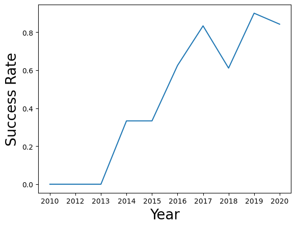
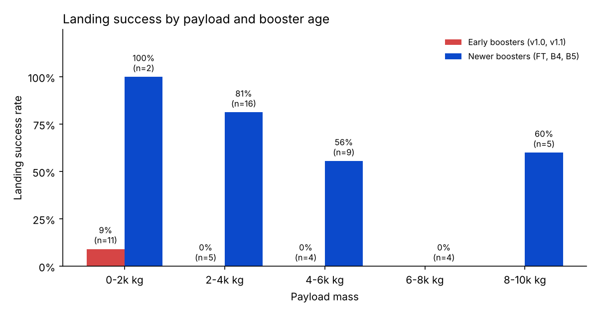
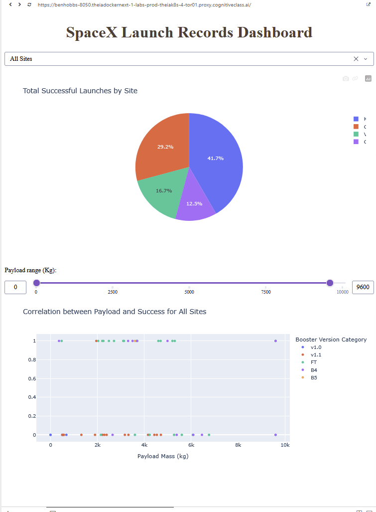

# SpaceX Falcon 9 First-Stage Landing Prediction

Capstone project for the [IBM Applied Data Science Capstone](https://www.coursera.org/learn/applied-data-science-capstone) on Coursera.

SpaceX advertises Falcon 9 launches at about $62 million, while other providers charge upwards of $165 million. Most of that saving comes from landing and reusing the first stage. This project predicts whether the first stage will land, which in turn estimates the cost of a launch for a company bidding against SpaceX.

**Final presentation:** [presentation/SpaceX_Capstone_Ben_Hobbs.pdf](presentation/SpaceX_Capstone_Ben_Hobbs.pdf)

## Key results

| | |
|---|---|
| First-stage landing rate | **66.7%** (60 of 90 Falcon 9 launches) |
| Best launch site | **KSC LC-39A**: 41.7% of all successful landings and a 76.9% success rate |
| Best payload range | **2,000 to 4,000 kg** (62% landed); 6,000 to 8,000 kg never landed |
| Best model | **KNN**: 83.3% test accuracy (15 of 18), 84.8% cross-validation accuracy |

- Landing success rose from 0% (2010 to 2013) to about 90% in 2019.
- GTO, the most common orbit, is the hardest to land (about 52%).
- KNN, SVM and logistic regression tie on test accuracy with identical confusion matrices. The decision tree scored best in cross-validation (88.9%) but worst on test (66.7%), so it overfits.



### Insight beyond the course tasks: booster age

Light payloads look risky in the dashboard, but that is mostly down to booster age. The early v1.0 and v1.1 boosters landed only **1 of 20** times, and they flew most of the light payloads. Newer boosters (FT, B4, B5) landed **81%** of the time at 2,000 to 4,000 kg. Heavy payloads of 6,000 to 8,000 kg failed every time, even on newer boosters.



## Repository structure

```
├── notebooks/
│   ├── 01-data-collection-api.ipynb           SpaceX REST API requests and cleaning
│   ├── 02-data-collection-webscraping.ipynb   Scraping launch records from Wikipedia
│   ├── 03-data-wrangling.ipynb                Landing outcome label (Class)
│   ├── 04-eda-sql.ipynb                       Exploratory analysis with SQL (SQLite)
│   ├── 05-eda-visualisation.ipynb             Exploratory analysis with charts; feature engineering
│   ├── 06-interactive-map-folium.ipynb        Launch site map and proximity analysis
│   └── 07-machine-learning-prediction.ipynb   Logistic regression, SVM, decision tree and KNN
├── dashboard/
│   ├── spacex-dash-app.py                     Plotly Dash dashboard
│   └── spacex_launch_dash.csv                 Data used by the dashboard
├── presentation/
│   └── SpaceX_Capstone_Ben_Hobbs.pdf          Final report
├── images/                                    Figures used in this README
└── requirements.txt
```

## Methodology

1. **Data collection.** Launch data from the SpaceX REST API (rocket, launch pad, payload and core details looked up by ID), plus launch records scraped from a June 2021 snapshot of Wikipedia's *List of Falcon 9 and Falcon Heavy launches* with BeautifulSoup.
2. **Data wrangling.** Filtered to Falcon 9 launches, filled missing payload mass with the mean, and turned eight landing outcomes into a binary `Class` label (1 = landed).
3. **Exploratory analysis.** Scatter, bar and line charts with seaborn, and ten SQL queries on SQLite.
4. **Interactive analytics.** A Folium map of launch sites, outcomes and distances to the coast, roads, railways and cities, plus a Plotly Dash dashboard with a site dropdown, payload slider, success pie chart and payload vs. outcome scatter plot.
5. **Prediction.** Standardised features, an 80/20 train/test split and `GridSearchCV` with 10-fold cross-validation for four classifiers, compared on test accuracy and confusion matrices.



## Running the project

```bash
pip install -r requirements.txt
```

**Notebooks.** These were completed in IBM Skills Network labs, and some run in the browser-based JupyterLite environment. To run them in standard Jupyter:
- skip the cells that start with `import piplite` / `await piplite.install(...)`
- replace the `from js import fetch` loading cells with `pd.read_csv(URL)` using the same URL

The SpaceX API (`api.spacexdata.com`) was returning Cloudflare errors (HTTP 522 / 525) when this project was completed. The data collection notebook checks the API first and falls back to IBM's prepared copy of the same dataset.

**Dashboard.** Run it from the `dashboard` folder so it can find its CSV:

```bash
cd dashboard
python spacex-dash-app.py
```

Then open http://127.0.0.1:8050 in a browser.

## Tools

Python, pandas, NumPy, requests, BeautifulSoup, Matplotlib, seaborn, SQLite (ipython-sql), Folium, Plotly Dash, scikit-learn
